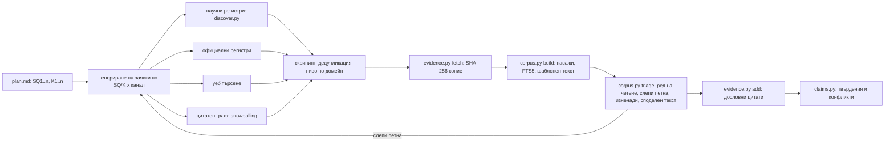

# Deep Research Engine v4.0 — архитектура

**Дата:** 2026-11-03 · **Статус:** частично внедрено (виж §6) · **Обхват:** всяка тема, 100–500+ източника

> Това е инженерен документ, не изследователски доклад. Числата за *нашата* система са
> измерени в тази папка и са посочени с файла, от който идват. Препоръките за външни
> библиотеки са инженерна преценка — проверете версията и лиценза преди инсталиране.

---

## 0. Тезата накратко

Тясното място при 300 източника не е скоростта на четене, а **къде отива вниманието** и
**какво може да се провери**. Три принципа следват от това:

1. **Моделът никога не чете корпуса целия.** Той чете проекция от слоеве, всеки от които е
   поне 10× по-малък от предходния: страници → пасажи → цитати → твърдения → конфликти → доклад.
2. **Всеки преход между слоевете е механично проверим:** символен диапазон в замразено копие,
   дословен подниз, число, обвързано с цитат, равенство на ключове. Халюцинацията престава да е
   неконтролиран риск и става *отказан запис*.
3. **Там, където механиката не стига (дали цитатът наистина доказва изречението), се използва
   статистическа извадка с горна граница на грешката,** а не твърдение за сигурност.

„100% проверено“ тук означава: 100% механична проверка на *произхода* (цитатът е на страницата,
числото е в цитата) и **ограничена, измерена** честота на грешки в *извода*. Повече от това не
може да се обещае честно — и §4.5 обяснява защо.

---

## 1. Диагноза: какво се чупи при мащаб (измерено, не предположено)

| # | Наблюдение | Измерване | Последствие |
| :-- | :-- | :-- | :-- |
| D1 | Контекстът не побира корпуса | FXIFY: 27 източника, 258 100 знака, средно 9 559 на източник (`sources/index.jsonl`). При 300 източника ≈ 2,9 млн. знака, т.е. ≈ 0,7–1 млн. токена | Без извличане (retrieval) моделът чете случайно избрана част и пропуска останалото |
| D2 | **Goodhart при процесните метрики** | В 35 проучвания: 744 търсения, 376 от тях за опровергаване (kill); **307 от 376 (82%) нямат записан резултат** (`opened: []`). В rp44 има 9 записа с бележка „Extra kill budget query for K1“ | Метриката „≥30% kill търсения“ се изпълнява на хартия; бюджетът е непроверим |
| D3 | EI не усеща дали докладът е верен | FXIFY: EI = 86,6/100 и гейтът е PASS; сляпата проверка намира 5 от 27 твърдения само частично подкрепени. След поправката EI остава 86,6 | Индексът мери входни процеси, не верността на изхода (§4.3) |
| D4 | Лексикална пропаст | „CySEC“ срещу „Cyprus Securities and Exchange Commission“: BM25 не свързва акроним с пълното име | Пропуснати пасажи при точно търсене (§2.2) |
| D5 | Филтърът за шаблонен текст крие синдикирано съдържание | Първата версия на `corpus.py` маркираше като шаблон всяко изречение, повторено в ≥3 източника. Прес-съобщение, препечатано на 5 сайта, ставаше невидимо | Скрива точно „скритите ключови доказателства“. Поправено (§2.1) |
| D7 | **Изключените секции са канал за контрабанда** | Гейтът и одитът пропускаха всяка секция със „Sources/Verification/Проверка“ в заглавието. (а) Във FXIFY друг агент беше добавил „Verification Addendum“, който обявява за *потвърдени* предупреждението на CNMV и лиценза MB/22/0097 — без нито един запис, а тялото на доклада ги води като непотвърдени. (б) В rp16 цялата секция „Проверка на убиващите хипотези“ беше изключена от проверката само заради думата „проверка“ | Нов гейт R13 + точно съвпадение на заглавието (§4.2) |
| D6 | Механичните гейтове не виждат изкривен обхват | 5-те частични твърдения във FXIFY минаха R1–R11: числата са в цитатите, но „$540.12“ важи само за $100 000 акаунт, а „само за нарушение на правило“ изпуска „с изключение на §7.3 или §12.2“ | Нужен е слой за смислова проверка — одитът (§4.1, L3) |

**Изводът:** метриките трябва да мерят **артефакти, произведени от инструменти**: резултатни
множества, диапазони, присъди на сляп проверител. Декларации на агента не са измерване.

---

## 2. Въпрос 1 — поглъщане и триаж на 100–300+ източника без слепи петна

### 2.1 Слоеве и бюджети

| Слой | Вход | Изход | Кой решава | Цел за загубата |
| :-- | :-- | :-- | :-- | :-- |
| L0 заявки | SQ/K от плана | 3 формулировки × канал | агент + речник на синоними | — |
| L1 откриване | заявки | 300–1000 кандидата с метаданни | API, без LLM | висок обхват, ниска цена |
| L2 скрининг | кандидати | 100–300 за изтегляне | дедупликация (DOI, каноничен URL, хеш на заглавие) + ниво по домейн (`traps.py`) | измерена чрез случайна извадка от отхвърлените (§2.4) |
| L3 изтегляне | URL | замразени копия `S###.txt` + SHA-256 | `evidence.py fetch` | — |
| L4 индекс | копия | пасажи ≤700 знака (3 изречения, стъпка 2) | `corpus.py build` | 0 — всичко е индексирано |
| L5 четене | пасажи | ~12 пасажа на точка от плана | BM25 + претегляне по IDF + лимит на източник | слепите петна се маркират (§2.3) |

**Бюджет на контекста (защо работи):** 15 точки от плана × 12 пасажа × ≤700 знака ≤ 126 000
знака ≈ 30 000 токена. Това е под 5% от корпус от 300 източника, а изборът кое да се прочете е
детерминистичен и възпроизводим.

**Измерена производителност** (`corpus.py`, stdlib `sqlite3` + FTS5):
- FXIFY: 27 източника → 2 416 пасажа за ~0,5 s. 1 083 пасажа (45%) са шаблонен текст —
  менюта, футъри, чат уиджети — и никога не се връщат.
- Синтетичен тест за мащаб (корпусът на FXIFY, копиран 12×): 324 източника → 29 052 пасажа за
  2,7 s, база от 14,3 MB. Тестът мери само пропускателна способност.

**Шаблонен текст ≠ синдикация** (поправка на D5):
- Изречение, повторено на ≥3 страници **от един и същ сайт**, е шаблон.
- Същото изречение на **различни сайтове** е синдикация, огледало или копиране. То остава
  търсимо, а `triage` докладва двойките (`shared_text`): *две копия на едно прес-съобщение са
  един източник за триангулация, не два*.
- Тестът `test_syndicated_text_stays_searchable_and_is_reported` пази това поведение.

### 2.2 Каналите и как се избягват слепи петна по канал

| Канал | Сила | Сляпо петно | Инструмент |
| :-- | :-- | :-- | :-- |
| OpenAlex / Crossref / arXiv / EuropePMC / Semantic Scholar | рецензирани статии, DOI, цитатен граф | регулаторни текстове, договори, „живи“ правила на фирми | `discover.py` (вече логва с резултатни множества) |
| Официални регистри (EUR-Lex, ESMA/CySEC/FCA регистри, Companies House, SEC EDGAR, Държавен вестник, NAP) | първичен юридически факт (T1/T2) | не са индексирани добре от търсачките; изискват директни заявки | `source-hierarchy.md` по домейн; заявка директно към регистъра |
| Уеб търсене | актуалност, практика (де факто), новини | SEO шум, афилиейт ревюта | WebSearch / Exa → `evidence.py fetch` |
| Цитатен граф (snowballing) | открива ключови статии, които заявките пропускат | наследява пристрастието на началните статии | OpenAlex `referenced_works` / `cited_by` (пътна карта) |

**Генериране на заявки:** за всяка точка SQ/K се пускат три формулировки:
1. с термините на хипотезата;
2. с термините на *опонента* — за K-точките това е задължително;
3. с жаргона на регулатора или научната област.

Речник на синонимите (`aliases.json` на проучване, пътна карта) разширява акронимите, напр.
CySEC ↔ Cyprus Securities and Exchange Commission. Това затваря D4 без тежки зависимости.

### 2.3 Механизми срещу „пропуснато скрито доказателство“

1. **Слепи петна (внедрено):** `corpus.py triage` пуска всяка точка от плана като заявка. Ако
   най-добрият пасаж покрива под 40% от IDF-претеглените ѝ термини, точката е сляпо петно и
   трябва да се търси извън корпуса.
2. **Опашка с изненади (внедрено):** изтеглени източници, които не отговарят на нито една точка
   и не са цитирани. Или са шум, или са ключов факт, за който планът няма въпрос. И двете
   трябва да се видят. При FXIFY опашката хвана точно 5 безполезни страници (чат уиджет и
   навигация), т.е. няма скрит ключов факт.
3. **Логове с резултатни множества (внедрено):** `corpus.py query --log --purpose K2` записва
   заявката *и* какво е върнала (`results: ["S005@2573-2957", ...]`). Гейтът E4 вече
   предупреждава, когато kill-търсенията нямат записан резултат (D2).
4. **Оценка на обхвата чрез повторно улавяне (пътна карта).** Ако два независими канала A и B
   намират съответно n₁ и n₂ релевантни източника, от които m общи, оценката на Chapman е
   N̂ = (n₁+1)(n₂+1)/(m+1) − 1.
   - Пример: n₁=12, n₂=9, m=4 → N̂ = 13·10/5 − 1 = 25. Намерени са 12+9−4 = 17, т.е. обхват
     ≈ 68% → продължава се.
   - **Честно ограничение:** каналите са положително зависими (и двата обичат популярни
     източници). Тогава N̂ е подценено и обхватът е *надценен*. Числото е горна граница на
     обхвата, не гаранция.
5. **Крива на насищане (пътна карта):** нови ключове на твърдения за всеки следващ пакет от 10
   източника. Спира се, когато за 2 поредни пакета има по-малко от 1 нов *решаващ* ключ и
   обхватът по т. 4 е ≥ 0,8.
6. **Измерване на загубата от скрининга (пътна карта):** изтеглят се 20 случайни кандидата от
   *отхвърлените* на L2 и се проверяват. Ако нито един не е релевантен, горната граница на
   загубата е 1 − 0,05^(1/20) ≈ 13,9% при 95%. С 59 проверени → ≤ 4,95%. Така „не пропуснахме
   нищо важно“ става измерено твърдение с граница.

---

## 3. Въпрос 2 — извличане без халюцинации от тежки PDF-и, таблици и отчети

### 3.1 Единицата доказателство е символен диапазон, не преразказ

`S003@1200-1490` е диапазон в замразено копие с фиксиран SHA-256. Моделът *предлага* цитат;
`evidence.py add` го приема само ако е дословен подниз на копието (след нормализиране на кавички
и интервали; многоточие само с ограничен пропуск). Числото в доклада трябва да е в цитата (R3),
иначе гейтът отказва. Всеки пасаж, върнат от `corpus.py`, вече е точен диапазон, т.е. може да
се подаде директно като `--quote`. Тестът `test_passages_are_exact_spans_of_snapshots` пази
това.

### 3.2 Каскада за извличане по точка от плана

| Стъпка | Метод | Статус | Защо |
| :-- | :-- | :-- | :-- |
| 1 | BM25 върху FTS5, 300 кандидата, `unicode61 remove_diacritics 2` | внедрено | бързо, детерминистично, работи и на кирилица |
| 2 | Пренареждане: 0,6 × покритие на IDF-претеглените термини + 0,4 × BM25 ранг | внедрено | наказва пасажи, които съвпадат само с честите думи |
| 3 | Лимит на източник (по подразбиране 2) | внедрено | един многословен сайт не изтласква останалите |
| 4 | Разширяване на заявката с речник на синоними | пътна карта (stdlib) | затваря D4 евтино |
| 5 | Плътно (dense) пренареждане: многоезичен модел за вграждания (напр. `BAAI/bge-m3`) + cross-encoder (напр. `bge-reranker-v2-m3`), сливане с BM25 чрез Reciprocal Rank Fusion (k=60) | пътна карта, **по желание** | семантично съвпадение без общи думи. Тежко (PyTorch, модели от GB) — изисква одобрение, а модулът трябва да пада обратно на BM25 |
| 6 | Прозорец от изречения: търси се по 3 изречения, а за четене се разширява ±1 прозорец | частично (`passage_spans`) | контекст за обхвата („само за $100 000 акаунт“) без да се надува цитатът |

**Защо не векторна база по подразбиране:** проверимостта идва от точния диапазон, не от
векторите. BM25 е детерминистичен и обясним (вижда се кой термин е съвпаднал). Плътните модели
добавят обхват при синоними, но не трябва да заместват точното съвпадение. RRF ги комбинира, без
да се налага калибриране на скалите им.

### 3.3 PDF-и и таблици

| Тип документ | Препоръка | Защо |
| :-- | :-- | :-- |
| Финансови отчети на листнати компании | **Не PDF**: XBRL/iXBRL — SEC EDGAR `companyfacts` API (САЩ), ESEF (ЕС) | числата идват структурирани, с единица и мащаб; таблицата не се парсва |
| Текстов PDF (закони, условия) | `pypdf` (чист Python, лек) | минимална зависимост; текстът става копие `S###.txt` като всяка страница |
| PDF с таблици | `pdfplumber` (координати на клетките); Camelot за решетъчни таблици | таблицата се запазва като TSV блок в копието, а локаторът е `S010@p12:t3:r5c2` |
| Научни статии | GROBID (TEI XML) или Docling | секции, бележки и библиография отделно; `parse_pdf.py` вече прави подобно почистване |
| Сканирани PDF-и | OCR (Tesseract) — с ниво максимум T4, докато цитатът не се сравни с оригинала | OCR грешките правят „дословен“ цитат несигурен |

**Правило за таблици:** цитатът от таблица = заглавие на реда + заглавие на колоната + клетката
+ **мащабът от заглавието на таблицата** („в хиляди“, „%“, „bp“). Мащабът е задължително поле
`unit` в `claims.py`. Иначе 1 000× грешките са невидими за механичната проверка.

> Статус в тази папка: при FXIFY PDF-ът на CySEC остана непрочетен, защото липсва PDF
> библиотека. `pypdf`/`pdfplumber` не са инсталирани — изискват одобрение (външен код).

### 3.4 Граф на знанието — колкото е нужен, не повече

`claims.py` е лек граф: ключ `(субект | атрибут)` → стойности → ребра към E-доказателства. Повече
не е нужно, защото двете задачи, които решаваме — откриване на конфликти и покритие, — изискват
*равенство на ключове*, не обхождане на граф. Пълна графова база (Neo4j и т.н.) добавя
инфраструктура без нова проверимост. Двете неща, които наистина липсват:
- нормализиране на субекти (речник на псевдоними: „FXIFY“, „FXIFY Solutions Limited“);
- предупреждение за почти еднакви ключове — внедрено (Jaccard ≥ 0,5 при `add`).

---

## 4. Въпрос 3 и 4 — карта на противоречията и двигател за проверка

### 4.1 Противоречия: формална дефиниция и оси на разминаване (внедрено: `claims.py`, R11)

**Конфликт** = две твърдения с еднакъв ключ `(субект | атрибут)` и несъвместими стойности:
- числови: относителна разлика над толеранса (по подразбиране 5%);
- категорийни: различна нормализирана стойност.

Мапърът обяснява всеки конфликт с осите, по които двете страни се различават:

| Ос | Как се открива | Правило за разрешаване |
| :-- | :-- | :-- |
| scope (обхват) | различно поле `scope` | обикновено и двете са верни → описват се и двете |
| time (време/версия) | различно `time` или дата на публикуване | важи най-новата версия в сила |
| method (метод) | различно `method` | сравняват се дизайните, не се осредняват |
| unit (единица/дефиниция) | различна единица при числа | нормализира се преди сравнение |
| authority (авторитет) | различно най-добро ниво T1–T5 | по-високото ниво печели, освен ако по-ниското е >90 дни по-ново |
| rule_vs_practice | de_jure срещу de_facto | не е противоречие — разликата *е* находката |
| **UNEXPLAINED** | нито една ос не се различава | разследва се (извадка, конфликт на интереси) или се маркира като неразрешен — R11 го изисква |

**Изолиране:** конфликтните стойности никога не се сливат в едно число. Докладът показва двете
страни с ос и правило, а R11 проваля доклада, ако конфликт от регистъра липсва в секцията
„Конфликти“ с доказателства *от двете страни*.

**Демонстрация (FXIFY):** мапърът намери 3 конфликта.
- Основната грешка на стария доклад — комисионна, валидна само за Raw фийда, приложена като
  универсална — излиза като ос **scope**.
- R11 веднага хвана, че в *новия* доклад липсва конфликтът за EA (1/2/3-Phase: разрешени след
  одобрение [E012] срещу Instant: забранени [E013]), въпреки че докладът беше минал предишния
  гейт.

**Добавки по пътната карта:**
- **interest (конфликт на интереси):** поле в доказателството — `issuer` (самата фирма),
  `affiliate` (ревю сайт с афилиейт връзки), `regulator`, `independent`. Повечето сайтове за
  ревюта на prop фирми са афилиейти; това трябва да е ос, не бележка под линия.
- **sample (извадка):** полета `n` и `population` за емпирични твърдения.
- **Мета-анализ за количествена литература:** DerSimonian–Laird τ² и I² = max(0, (Q − df)/Q).
  - I² < 25%: обединява се.
  - 25–75%: модел със случайни ефекти плюс анализ на модератори — модераторът *е* оста.
  - Над 75%: не се обединява, докладват се подгрупите.
  - Тест на Egger за ефект на малките изследвания при k ≥ 10.
  - Реализация: stdlib функция в `calc.py` (около 40 реда), за да е в `[C###]` веригата.
- **Карта на аргументите:** всеки извод D в „Bottom line“ изброява носещите си твърдения CL###
  (§4.3 ги използва).

### 4.2 Двигателят за проверка: три слоя

| Слой | Какво доказва | Механизъм | Покритие |
| :-- | :-- | :-- | :-- |
| **L1 Произход** | цитатът е на страницата; числото и датата са в цитата; връзката е жива | SHA-256 копия, дословно съвпадение, R3 обвързване на числа и ISO дати, `--live` извадка | 100%, механично |
| **L2 Консистентност** | сметките са верни; няма скрит конфликт; увереността не надхвърля доказателствата; няма находки, скрити в неодитирани секции | `calc.py` (AST, без `eval`), `claims.py` (R11), таван на увереността (R10), R13; проверка на единици (пътна карта) | 100% от регистрираното, механично |
| **L3 Следване (entailment)** | цитатът *наистина* подкрепя изречението такова, каквото е написано | `audit.py`: извадка, засята от SHA-256 на доклада, сляп проверител, граница на грешката (R12) | извадка → **граница**, не сигурност |

**Проверка на единици (пътна карта, `units.py`, stdlib):**
- канонични измерения: валута, %, bp, лот, договор, точка, време;
- преобразувания: bp↔%, мащаб k/m/bn, „на страна“ ↔ „round turn“ (RT = 2 × на страна).

Пример от домейна: „$3 на страна“ и „$6 RT“ са една и съща комисионна. Без нормализиране
мапърът ще отчете фалшив конфликт; с нормализиране — истински конфликт при $3 RT срещу $6 RT.

**R13 — изключените секции (внедрено):**
- Секция е изключена само ако заглавието ѝ *е* „Източници/Sources/Проверка (Verification)“, а
  не ако просто съдържа думата. Подсекциите наследяват родителя си. Помощната функция
  `check_report.heading_exempt` се ползва от `gate.py`, `audit.py` и `formula.py`, така че
  трите да броят едно и също.
- В изключена секция ред с думи-присъди („confirmed“, „потвърдено“, „refuted“, „присъда“) без
  [E###]/[C###] → **FAIL**. Друго нецитирано твърдение → предупреждение. Пътища и команди в
  `code` не се броят.

**L3 в детайли (внедрено):**
1. `audit.py sample` тегли n единици с твърдения. Семето е SHA-256 на доклада, така че агентът
   не може да избере удобни изречения.
2. Проверителят вижда *само* изречението, цитираните цитати и копията. Не вижда плана,
   доклада, регистъра на твърденията и т.н.
3. Присъди: supported / partial / unsupported / wrong_number / misattributed. Всичко освен
   supported е грешка.
4. Граница: точна хипергеометрична при известна популация (крайна популация), Clopper–Pearson
   иначе. Еднострани 95% граници:
   - 0/30 при голяма популация → 9,5%; 1/30 → 14,9%; 0/59 → 4,95%;
   - 0/30 от 60 единици → 6,7%; пълно преброяване → точният дял.
5. Известна грешка блокира доклада **независимо от границата.** Тази дупка беше открита от
   тест: при 1/30 границата е 14,9% < 15% и гейтът щеше да пропусне доклад с известна невярна
   фраза.
6. Повторен одит след поправки: присъдите се пренасят само към изречения с идентичен текст *и*
   цитати. Поправените отиват при *нов* сляп проверител, т.е. проверява се и поправката, не
   само изтриването на грешката. Историята на кръговете се пази (`audit/history/`).

### 4.3 Epistemic Index: критика и EI v2

**Сегашният EI** (`formula.py`): EI = 100 × (0,35·A_E + 0,25·T_D + 0,20·S_K + 0,20·V_Q).

| Проблем | Защо е проблем | Доказателство |
| :-- | :-- | :-- |
| Компенсаторен | много T1 цитати (A_E) компенсират слабо опровергаване (S_K). Решение пада, ако *един* носещ вход е грешен, а средното скрива това | — |
| Произволни тегла | 0,35/0,25/0,20/0,20 не са напаснати към никакъв резултат | няма калибрационни данни |
| Мери процес, не изход | броят търсения и нивата не казват дали изречението е вярно | D3: EI 86,6 и преди, и след поправката на 5 частични твърдения |
| Може да се играе | падинг на kill търсения повдига процесните компоненти | D2: 307/376 без резултат |

**EI v2 — некомпенсаторен, ориентиран към изхода:**

1. **Надеждност на носещо твърдение c:**
   r_c = 1 − ∏_g (1 − q_g),
   където g са *независимите* групи източници (по издател и хост, след сливане на двойките
   споделен текст от §2.1), а q_g е априорната надеждност на най-доброто ниво в групата.
   - Начални априорни стойности: T1 0,95 · T2 0,90 · T3 0,80 · T4 0,60 · T5 0,30.
   - Корекции:
     - de_jure източник за твърдение за *практика* → таван 0,7;
     - неразрешен конфликт по ключа → × 0,5;
     - UNEXPLAINED → таван 0,5.
2. **Надеждност на извод D** = min по носещите му твърдения (най-слабото звено): R(D) = min r_c.
3. **Следване:** U = горната граница от одита (L3).
4. **Обхват:** Ĉ = min(1, намерени / N̂) за решаващите точки (§2.3). Ако не е измерен, тава
   на увереността е Medium.
5. **EI₂ = 100 × (1 − U) × R_min × Ĉ.** Отделно се докладват и четирите компонента: произход
   (PASS/FAIL), U, R_min, Ĉ. Едно число без компонентите скрива слабото звено.

**Тавани на увереността:**

| Ниво | Условия |
| :-- | :-- |
| High | U ≤ 10%, R_min ≥ 0,9, Ĉ ≥ 0,8, без неразрешен конфликт сред носещите твърдения |
| Medium | U ≤ 20% и R_min ≥ 0,7 |
| Low | всичко останало |

**Калибриране — затворен цикъл:**
- Всяка присъда от одит е етикетиран пример „твърдение на ниво T_x → подкрепено или не“.
- Априорните q_T се обновяват бейсиански: q_T = (подкрепени_T + α) / (n_T + α + β), с начално
  разпределение Beta(α, β), центрирано в началните стойности.
- `dr_engine/evals` (32 случая) дава отделен тестов набор.
- Обявената увереност се оценява срещу повторна проверка след 90 дни чрез Brier score.

Докато няма достатъчно данни, q_T са **априорни стойности, обявени като такива**, а не измерени
вероятности.

### 4.4 Механизми срещу потвърждаващо пристрастие (confirmation bias)

1. **Предварителна регистрация:** SHA-256 на `plan.md` се заключва преди първото доказателство.
   Промяна след това изисква запис в changelog (пътна карта: предупреждение в гейта).
2. **Kill хипотези с резултатни множества:** E4 предупреждава при търсения без записан резултат
   (внедрено). Целта е E4 да брои *само* такива търсения.
3. **Симетрично извличане:** `triage` дава на всяка K-точка същия бюджет пасажи като на
   SQ-точките и маркира K-слепите петна (внедрено).
4. **Задължени противоречащи доказателства:** доказателство със stance=contradicts трябва да е
   адресирано в текста (R4, съществуващо).
5. **Сляп проверител и засята извадка** (внедрено, L3).
6. **Отделен red-team агент** (пътна карта): вижда само таблицата с твърдения и изводите, и
   строи най-силния обратен случай. Изходът му се третира като нови K-хипотези.

### 4.5 Какво е честно невъзможно

- **100% сигурност за следването:** при извадка остава граница. Само пълно преброяване от
  независим проверител я сваля до нула, и то само *за мнението на този проверител*.
- **Факт, който го няма в нито един източник:** обхватът (§2.3) дава оценка, не доказателство за
  отсъствие.
- **Източник, който лъже:** T1 страница на фирма е обвързваща за *правилата* ѝ, но не доказва
  *практиката*. Затова съществува оста rule_vs_practice.
- **Проверителят е модел:** присъдите му имат собствена грешка. Мярка: периодично двойно
  оценяване (два независими проверителя, плюс човек на извадка) и изчисляване на съгласието
  (Cohen's κ).

---

## 5. Въпрос 5 — стъпка по стъпка

| # | Стъпка | Инструмент | Артефакт | Проверка |
| :-- | :-- | :-- | :-- | :-- |
| P0 | Обхват и хипотези | `evidence.py init` | `plan.md` (въпрос, решение, SQ, ≥3 K, прагове) | E2 |
| P1 | Откриване | `discover.py --dir`, уеб търсене, регистри | `searches.jsonl` *с резултати* | E3, E4 |
| P2 | Скрининг и изтегляне | `evidence.py fetch` | `sources/S###.txt` + SHA-256 | E1 |
| P3 | Индекс и триаж | `corpus.py build` / `triage` | `corpus.sqlite`, слепи петна, изненади, споделен текст | цикъл към P1, докато няма слепи петна |
| P4 | Извличане | `corpus.py query --log` → `evidence.py add` → `claims.py add` | `evidence.jsonl`, `claims.jsonl` | дословно; числата са обвързани |
| P5 | Сметки | `calc.py eval` / `decision` | `calculations.jsonl` `[C###]` | R3, R7 |
| P6 | Конфликти | `claims.py conflicts` | оси на всеки конфликт | R11 |
| P7 | Чернова | от `claims.py table`, не от суровите страници | `report.md` | — |
| P8 | Гейт | `gate.py --live 5 --scorecard` | PASS/FAIL, EI | E1–E8, R1–R11 |
| P9 | Одит | `audit.py sample` → сляп проверител → `record` → поправки → `sample` отново | `audit/sample.json`, граница U | R12 (`--require-audit`) |
| P10 | Публикуване | копие в `reports/` | финален доклад с карта на решението и границата U | — |

### 5.1 Внедрено в тази итерация

| Модул | Какво прави | Тестове |
| :-- | :-- | :-- |
| `dr_engine/tools/corpus.py` | FTS5/BM25 индекс от точни диапазони, шаблонен текст по сайт, синдикация като отделен сигнал, триаж (слепи петна, изненади, споделен текст), заявки с лог на резултатите | 6 |
| `dr_engine/tools/claims.py` | регистър на твърденията с обвързани числа, откриване на конфликти и оси | 4 |
| `dr_engine/tools/audit.py` | засята извадка, сляп бриф, хипергеометрична и Clopper–Pearson граница, повторен одит с пренесени присъди, история | 5 |
| `gate.py` R11, R12, R13, E4 | конфликтите в доклада; одитът като условие; без находки в изключени секции (и точно разпознаване на тези секции); предупреждение за непроверим kill бюджет | 6 |

**Протокол 4.1 (P1 от пътната карта, внедрено 2026-11-03):**

| Модул | Какво прави | Тестове |
| :-- | :-- | :-- |
| `dr_engine/tools/units.py` | Разпознава единиците в твърденията и ги свежда до обща база: bp↔%, RT↔на страна, годишно↔дневно (ACT/365), валута. Изчисления: разход за задържане = спред + нощи × дневна ставка (капан G9); нетно финансиране на long/short книга (дългото рамо плаща, късото получава, а бенчмаркът се съкращава); bp на цената ↔ R. Функциите са регистрирани в `calc.py`, така че резултатът може да стане `[C###]` | 5 |
| `claims.py` + `units.py` | „3 USD на страна“ = „6 USD RT“ → не е конфликт. „6% годишно“ срещу „1,5 bp на сделка“ → ос `unit` с подсказка за `hold_cost_bp`. Ако едната страна не казва дали е RT, или на страна → ос `unit` (там се крие грешката от 2×) | 2 |
| Оси `interest` и `sample` | Нови полета в `evidence.py add`: `--interest` (academic / regulator / independent срещу issuer / affiliate / vendor), `--sample-period`, `--sample-type` (in_sample / out_of_sample / post_publication / live). Конфликт с ос `interest`, когато едната страна има интерес, а другата не; собственият сайт на субекта се разпознава като issuer дори без флаг. Ос `sample` при различен тип извадка или период, като периоди без припокриване се отбелязват (напр. преди/след криза) | 3 |
| `corpus.py` + `aliases.json` | Глобален речник: 43 групи — регулатори (CySEC, SEC, ESMA, CFTC, FCA, BaFin, ...), централни банки (ECB, Fed, BIS, IMF), наука и медицина (NBER, FDA, EMA, NIH, WHO) и български институции (КФН, БНБ, НАП, ДВ, ЗДДФЛ, ДОПК). Проучването може да има собствен `aliases.json`: групи, които се сливат с глобалните, и `disable` (напр. EMA = пълзяща средна в трейдинг проучване). Заявката се разширява в FTS5 с `NEAR(...)`, а покритието брои понятия, не думи. `corpus.py aliases` показва разширението, а логът записва `expanded` | 3 |
| E4, строг режим | Броят се само kill търсения със записан резултат (отворени страници, локатори или търсене от инструмент с изричен брой резултати). Нужни са ≥ 30% от бюджета и ≥ 3 на всяка K. Строгият режим важи, когато `study.json` (създава се от `evidence.py init`) казва protocol ≥ 4.1 или когато папката е с дата ≥ 2026-11-04. Архивите остават с предупреждение; `--strict-kill-results` го налага ръчно. Пуснат принудително върху rp44 дава 0/34 | 3 |

Целият набор: 116 теста, OK (`.venv\Scripts\python.exe -m unittest discover -s tests`).
Пуснат върху всички 35 проучвания: никакви сривове и същите 8 PASS / 27 FAIL като преди
промените. R13 само предупреждава за самоотчетени процесни редове („verified against gates
E1–E8“); FAIL остава само за присъди *за субекта*.

**Протокол 4.1, P2 (внедрено 2026-11-03).** Изискване от потребителя: протоколът се изпълнява
и от по-слаби модели, затова всяка стъпка трябва да е алгоритмична, а инструментите да спират с
точно съобщение какво да се направи.

| Модул | Какво прави | Тестове |
| :-- | :-- | :-- |
| `parse_pdf.py` + `pdfplumber` | Таблиците се изрязват от прозата и се записват след страницата като редове, които се самоописват: `p3.t1 header: Item \| 2025 \| 2024`, `p3.t1 r1: Revenue \| 2025: 1,234 \| 2024: 1,100`, плюс ред `units` (мащабът над таблицата, напр. „in thousands of USD“). Един цитиран ред носи етикета, колоната и мащаба. `evidence.py fetch` минава през същата функция. Сканиран PDF (под 200 знака текст) се отказва с указание за OCR | 6 |
| `corpus.py stats` | Оценка на Chapman $\hat N = (n_1+1)(n_2+1)/(m+1) - 1$ с дисперсия на Seber за броя релевантни източници (цитирани поне веднъж) между два независими канала (web, registry, scholarly, citation); `corpus` заявките не са откриване. Крива на насищане: нови ключове от регистъра (`load_bearing` = решаващи) на всеки 10 източника. `SATURATED` = покритие ≥ 80% и под 1 нов решаващ факт във всяка от последните 2 пълни партиди. Когато няма канали, има само един или няма общ източник, казва точно това вместо число. `--save` пише `coverage.json` | 6 |
| `discover.py --snowball` | Назад (`referenced_works`, на партиди по 50 с OR филтър) и напред (`cited_by_api_url`, по брой цитирания). Учтив клиент: ≥ 1 s между заявките (`OPENALEX_MIN_INTERVAL`), повторение при 429/5xx с `Retry-After`, `mailto` само от `OPENALEX_MAILTO`, никога вписан адрес. Всеки резултат отива в `searches.jsonl` (канал `citation`) и в `candidates.jsonl` (`L###`) | 5 |
| `screening.py` | Засята извадка (20–50) от следите, които търсенията са върнали, но никой не е изтеглил; семето е SHA-256 на сортирания списък. Присъди relevant / irrelevant / duplicate (иска `--source`) / unreachable (не се брои). Горна граница на дела изгубени релевантни следи: Clopper-Pearson и точна хипергеометрична за крайния списък. Следа, призната за релевантна, но неизтеглена, проваля E9 | 5 |
| `gate.py` E9 | FAIL: неоценени елементи в извадката или релевантна неизтеглена следа. WARN: граница > 20%, остарял `coverage.json`, присъда различна от `SATURATED`; в строгите проучвания (4.1) и липсващ скрининг/покритие | 1 |
| `evidence.py retract` | Правилото „никога не редактирай `evidence.jsonl` на ръка“ оставяше агента без законен начин да поправи грешен запис. `retract --id E### --reason` маркира записа (остава във файла за одитната следа, номерът не се преизползва); гейтът и всички инструменти го пренебрегват чрез `load_evidence`, а доклад, който още го цитира, пада на R2. `next_step.py` праща E2/E6/E7-дубликат към `retract` + ново `add` | 2 |
| `study_dir_error` | Всеки инструмент с `--dir` проверява папката първо: несъществуваща или без `plan.md` → exit 2 и последните 5 проучвания като подсказка; нищо не се създава | 2 |
| `next_step.py` | Детерминистичен автомат: план → E1–E9 по приоритет → корпус и регистър → пълнота (4.1) → чернова → R1–R13 → сляп одит → финален гейт → копие в `reports/` (сравнява SHA-256). Печата ЕДНО действие с точната команда и причината; `--json`; exit 0/1/2. Върху 36-те папки: без сривове, FXIFY = DONE | 5 |

Целият набор: 147 теста, OK. Гейтът върху всички 35 проучвания: същите 8 PASS / 27 FAIL, без
сривове. Открит и поправен страничен бъг: `re.sub(r'\\s+', ...)` вътре в f-string (разрешено от
Python 3.12) търси буквална обратна наклонена черта, защото raw низът запазва и двете `\`; затова
ключовете за насищане без регистър не нормализираха интервалите. Същото беше в `next_step.py`.

### 5.2 Пътна карта по приоритет

| Приоритет | Задача | Зависимост | Усилие |
| :-- | :-- | :-- | :-- |
| ~~P1~~ | ~~Синоними, `units.py`, E4 като провал, оси interest/sample~~ — внедрено, виж §5.1 | — | — |
| ~~P2~~ | ~~Chapman и насищане, snowballing, PDF таблици (`pdfplumber`, одобрено), скрининг на отхвърлените, `next_step.py`~~ — внедрено, виж §5.1 | — | — |
| P3 | EI v2 в `formula.py` редом с v1; калибриране по присъдите от одитите | stdlib | средно |
| P3 | Мета-анализ (DerSimonian–Laird, I², Egger) в `calc.py` | stdlib | средно |
| P3 | Плътно пренареждане (bge-m3 + RRF) като незадължителен модул | **тежки външни пакети** | голямо |
| P3 | Заключване на плана; отделен red-team агент | stdlib + агент | малко |

### 5.3 Цена на одита (измерена)

Слепият одит на 27 единици от FXIFY отне на проверителя (подагент) около 177 000 токена, 19
извиквания на инструменти и около 5,4 минути. Повторният одит засяга само променените изречения,
защото останалите присъди се пренасят. За евтин проверител (по-малък модел) първо трябва да се
измери съгласието му с основния проверител на обща извадка.

---

## 6. Демонстрация от край до край: FXIFY срещу GetLeveraged

| Етап | Резултат |
| :-- | :-- |
| Гейт преди v4 | PASS, EI 86,6/100 |
| R11 (нов) | FAIL: липсващ конфликт за EA (E012 срещу E013) и конфликт за комисионната, цитиран с грешните доказателства → поправено |
| Одит, кръг 1 (пълно преброяване, 27 единици, сляп проверител) | **5/27 частично подкрепени**, граница 18,5% → R12 FAIL |
| Петте грешки | <ul><li>A01: „FXIFY не публикува“ спреда — недоказано, а друг източник твърди обратното.</li><li>A15: $540.12 важи само за $100 000 акаунт.</li><li>A18: „само за нарушение на правило“ изпуска изключенията по §7.3 и §12.2; „ревюта с тема отказани изплащания“ е преувеличено.</li><li>A26: „стесняват“ — няма база за сравнение в цитатите.</li><li>A27: „е софтуерна фирма“ — само самодеклариран код 62012, а сайтът я описва като „payment agent“.</li></ul> |
| Бонус находка | Таксата от $25, водена като „непроверена“, е частично потвърдена от текущите условия: $25 за wire/Revolut/Rise, без такса за карта и крипто |
| Поправки | 3 нови доказателства (E051–E053), 7 изречения коригирани; 21 присъди пренесени, 6 изречения пратени на нов сляп проверител |

| Одит, кръг 2 (нов сляп проверител, само 6-те променени изречения) | 6/6 подкрепени → 0/27 грешки, граница 0,0% (пълно преброяване) → **гейт PASS с `--require-audit --live 5`** |
| Гранични случаи | A27 „кодът е самодеклариран“ се опира на банера на същата страница в Companies House („does not check the accuracy of the information filed“), а не на цитирания ред. Проверителят го прие като контекст според брифа и сам отбеляза, че иначе би бил partial |
| EI | 86,6 преди и след — потвърждава критиката в §4.3: индексът не реагира на 5 поправени грешки |
| R13 (нов) | FAIL: „Verification Addendum“ (добавен от друг агент) обявява CNMV и Labuan MB/22/0097 за потвърдени без доказателства; никое копие в `sources/` не ги потвърждава. Текстът е преместен дословно в `unverified_addendum.md`, а тялото продължава да ги води като Unverified. Таблицата с източници е регенерирана (E051–E053) |
| Финален гейт | PASS с `--live 5 --scorecard --require-audit`; остават 2 предупреждения: E1 (ръчно копие на стария доклад) и E4 (kill търсенията от октомври нямат записани резултати) |

0,0% тук означава „0 грешки според *този* проверител при пълно преброяване“, а не „докладът е
безгрешен“ (§4.5).

**Поуката:** всичките пет грешки имаха числа, обвързани с цитати, и минаха всеки механичен
гейт. Грешаха в *обхвата* — точно класът грешки, който само смислова проверка хваща. Затова
L3 не е „хубаво е да има“, а е единственият слой, който мери верността на изводите.
